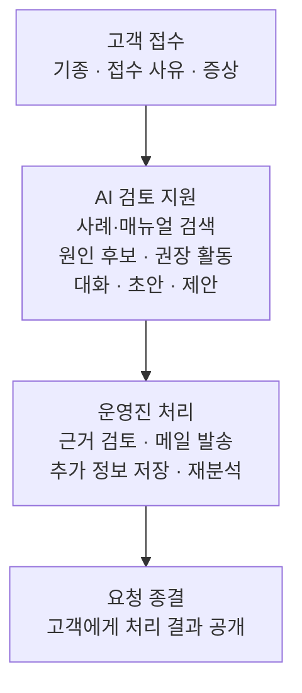
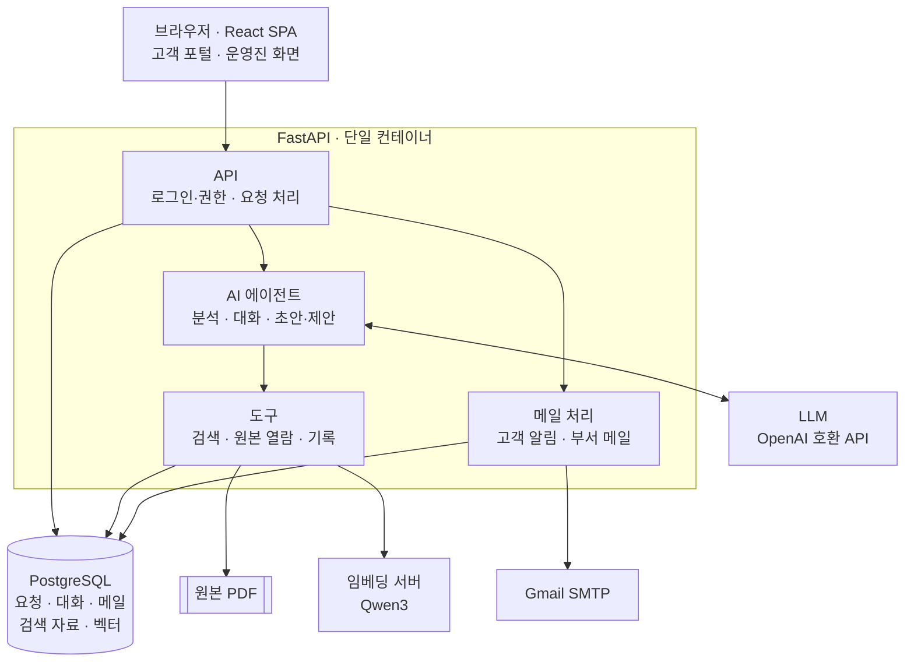
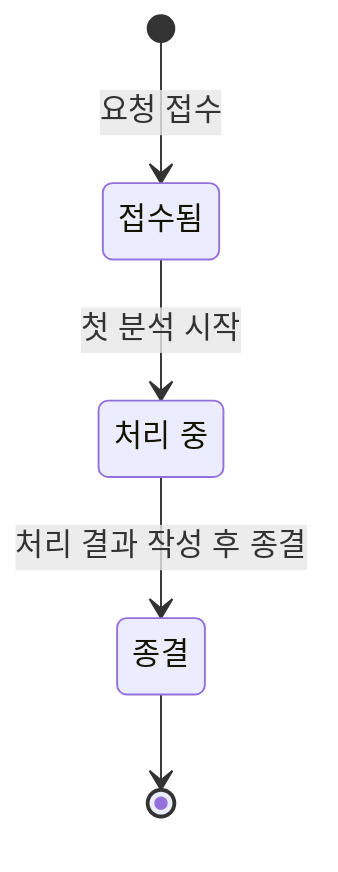
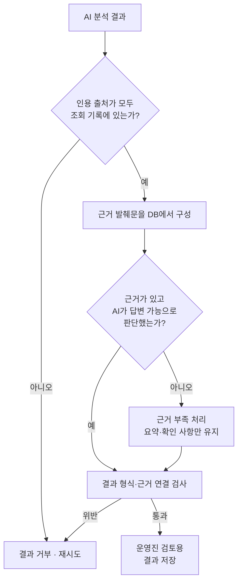
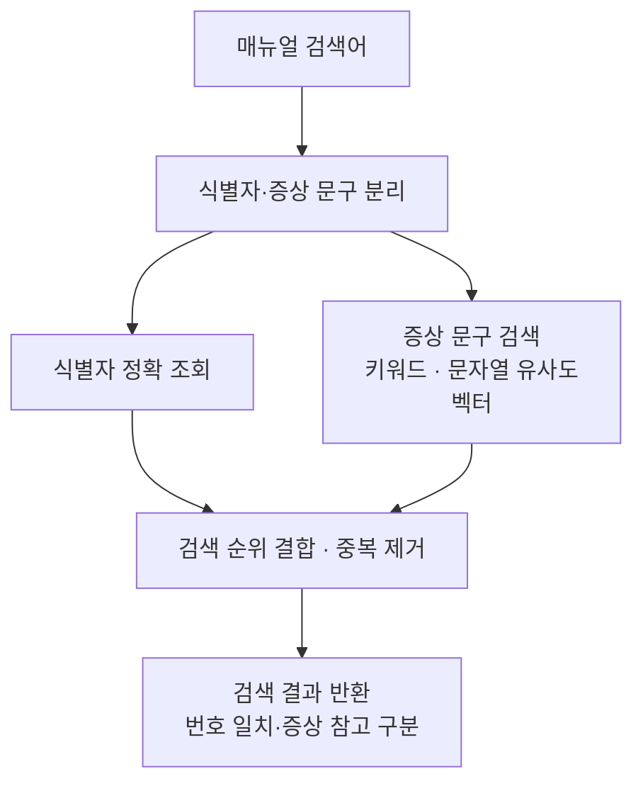
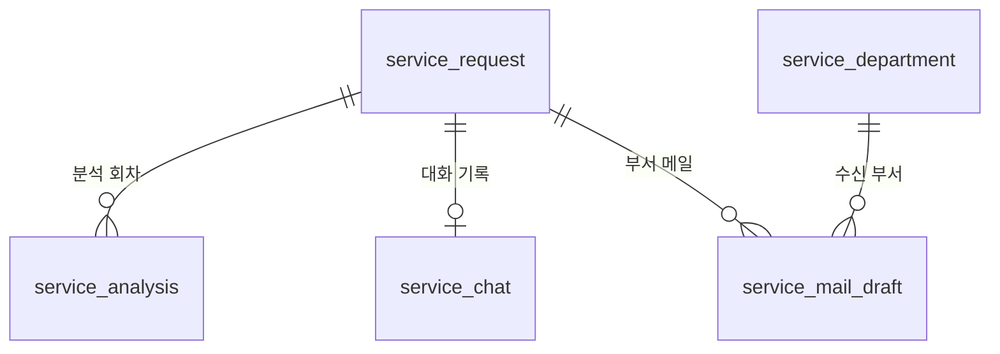

# MORRONO — 공작기계 A/S 요청 AI 분석 서비스

## 목차

1. [개요](#1-개요)
2. [데모](#2-데모)
3. [기술 스택](#3-기술-스택)
4. [시스템 아키텍처](#4-시스템-아키텍처)
5. [서비스 요청 흐름](#5-서비스-요청-흐름)
6. [AI 에이전트](#6-ai-에이전트)
7. [RAG: 데이터 준비·검색·원본 확인](#7-rag-데이터-준비검색원본-확인)
8. [데이터 모델](#8-데이터-모델)
9. [실행 방법](#9-실행-방법)
10. [AI 윤리](#10-ai-윤리)
11. [이미지 출처](#11-이미지-출처)

---

## 1. 개요

### 문제

- A/S 접수 후 담당자가 기종별 매뉴얼(PDF)과 과거 서비스 이력을 직접 찾아 원인을 추정
- 서비스·품질·부품·영업 중 담당 부서와 요청할 내용을 판단한 뒤 별도로 연락
- 매뉴얼은 표·도면·알람 목록이 혼재되어 키워드 검색만으로 필요한 정보를 찾기 어려움
- 알람 번호·부품번호는 한 글자 차이로 의미가 달라 정확한 조회와 원본 대조가 필요

### 해결 방식



- AI가 매뉴얼·과거 사례를 검색해 원인 후보와 권장 활동을 근거와 함께 제시
- 운영진은 분석과 대화를 같은 화면에서 이용하며, 근거 추가 조회와 부서 메일 초안 작성 가능
- 메일 발송, 추가 정보 저장, 재분석, 종결은 운영진이 직접 실행
- 고객은 접수 내용·진행 상태·이력을 확인하며, 종결 후 운영진이 작성한 처리 결과 확인 가능

---

## 2. 데모

| 항목 | 값 |
|---|---|
| URL | https://demo.morrono.com |
| 운영진 계정 | `admin` / `admin` |
| 고객 계정 | `user` / `user` |

| 역할 | 화면 | 주요 기능 |
|---|---|---|
| 고객 | `/#/portal` 내 서비스 요청 | 요청 접수, 접수 내용·진행 상태·이력 확인, 종결 후 처리 결과 확인 |
| 운영진 | `/#/cases` 서비스 요청 대기열 | 분석·대화, 근거 검토, 부서 메일 작성·발송, 추가 정보 저장·재분석, 종결 |
| 운영진 | `/#/departments` 부서 메일 설정 | 부서 추가, 수신 주소·사용 여부 변경 |

사용 순서:

1. `user`로 로그인 후 기종·접수 사유·증상을 입력해 접수
2. `admin`으로 로그인 후 해당 요청에서 **분석 시작** 선택 → `처리 중`으로 전환
3. 분석 결과와 근거 검토 후 필요에 따라 대화, 부서 메일 작성·발송, 추가 정보 저장·재분석 진행
4. 처리 결과 입력 후 **요청 종결** 선택 → `user` 계정에서 완료 상태·처리 결과 확인

> 데모 계정은 일반 계정의 비밀번호 규칙(12자 이상)을 따르지 않는 사전 생성 계정이며, 앱 실행 시 자동 생성되지 않음. 공개된 운영진 계정으로 유료 LLM 호출과 부서 수신 주소 변경이 가능하고, SMTP 설정 시 실제 메일도 발송 가능. 외부 공개 전 계정·접근 권한과 메일 설정 점검 필요.

---

## 3. 기술 스택

| 영역 | 사용 기술 |
|---|---|
| 프런트엔드 | React 19, Vite 6, Vercel AI SDK(`ai`, `@ai-sdk/react`) |
| 백엔드 | Python 3.12, FastAPI, Uvicorn, Pydantic |
| AI 에이전트 | PydanticAI 2.64.0, OpenAI 호환 Chat Completions API |
| 임베딩 | Qwen3 Embedding (`qwen3-embedding-0.6b`, 기본 1024차원) |
| DB·검색 | PostgreSQL, pgvector, pg_trgm, 전문 검색(tsvector) |
| 문서 처리 | pypdfium2, Pillow, markdown-it-py |
| 메일 | aiosmtplib, email-validator, Gmail SMTP(TLS 465) |
| 인증 | Argon2 비밀번호 해시, 서버 세션·HttpOnly 쿠키, CSRF 토큰 |
| 테스트 | pytest, Playwright |
| 배포 | Docker 멀티스테이지 단일 이미지 |

---

## 4. 시스템 아키텍처



- 화면과 API를 같은 주소에서 제공하며, 쓰기 요청은 Origin–Host 비교와 CSRF 토큰으로 검사
- 분석은 백그라운드에서 실행하고 화면에서 상태를 주기적으로 조회. 대화 답변은 Vercel AI SDK 프로토콜로 스트리밍
- 분석 실행 복구와 대화 동시 실행 관리가 단일 프로세스를 전제로 하므로 서버 프로세스는 1개로 운영
- 앱 시작 시 DB 스키마를 변경하지 않으며, 스키마 변경은 마이그레이션 CLI로 수행

### 코드 구조

```text
backend/
  app/
    auth/                 로그인·세션·CSRF·역할 검사
    service_requests/     접수·분석·대화·제안 확인·종결
    agent_rag/            검색 도구·문서 적재·임베딩·PDF 열람
    mail/                 고객 알림·부서 설정·메일 초안·발송
  migrations/             DB 스키마 변경 (001~027)
  scripts/                마이그레이션·적재·색인·계정·테스트 CLI
  quality/                분석 품질 평가
  tests/                  단위·DB 통합·브라우저 E2E 테스트
frontend/
  src/                    React 화면·API 클라이언트
  e2e/                    격리 DB 기반 브라우저 E2E
  e2e-live/               실제 모델 기반 인수 E2E
```

---

## 5. 서비스 요청 흐름

### 요청 상태



- **접수됨**: 고객이 기종·접수 사유·증상을 입력한 상태. 회사와 접수자는 로그인 계정을 기준으로 서버에서 기록
- **처리 중**: 운영진이 첫 **분석 시작**을 선택하면 상태 변경과 고객 이력의 “담당부서에서 처리를 시작했습니다.” 기록을 같은 트랜잭션에서 처리. 분석 실패 시에도 상태를 유지하며 재시도 가능하고, 재시도·재분석 시 시작 이력은 중복 생성하지 않음
- **종결**: 실행 중인 분석이 없을 때 운영진이 처리 결과 입력 후 종결. 고객 화면에는 `완료`로 표시

### 운영진 확인이 필요한 작업

| 작업 | 처리 방식 |
|---|---|
| 부서 메일 발송 | 직접 작성하거나 AI가 생성한 초안을 검토·수정한 뒤 **보내기** 선택 |
| 추가 정보 저장 | 전화·현장 확인 등으로 확보한 내용을 대화에서 전달한 뒤 제안 카드 확인. 작성자·시각과 함께 누적 저장(최대 2000자) |
| 재분석 | **재분석** 버튼 또는 제안 카드에서 실행. 저장된 추가 정보를 분석 입력에 반영 |
| 종결 | 고객에게 공개할 처리 결과 입력 후 **요청 종결** 선택 |

AI는 메일 초안과 제안을 기록할 수 있지만, 발송·추가 정보 반영·재분석·종결을 직접 실행하지 않음. 추가 정보 저장만으로 분석이 시작되지는 않음.

### 고객 공개 범위

- 공개: 접수 내용, 요청 상태, 고객용 이력, 종결 후 운영진이 작성한 처리 결과
- 비공개: AI 분석·대화, 매뉴얼·원본 페이지·근거 발췌문, 운영진 확인 사항·추가 정보, 부서 메일, 과거 사례 담당 기록
- 접수 이후 고객에게 추가 질문을 전송하거나 답변을 입력받는 화면은 제공하지 않음
- 별도 내부 댓글·고객 공개 답변 기능과 작성 API는 제공하지 않음. 고객 안내는 종결 시 작성하는 처리 결과로 통일

### 메일

| 구분 | 수신 대상 | 발송 시점·내용 |
|---|---|---|
| 고객 알림 | 접수 계정의 로그인 아이디가 유효한 이메일인 경우 | 접수·처리 시작·종결 시 자동 발송. 고정 양식에 요청 번호·기종·접수 사유를 포함하며, 종결 메일에는 운영진의 처리 결과도 포함 |
| 부서 메일 | 부서 설정에 등록된 수신 주소 | 운영진이 내용을 검토하고 **보내기** 선택 시 발송 |

- **부서 설정**: `/#/departments`에서 수신 주소·사용 여부를 관리하고 마지막 변경자·시각 기록. 발송 시 서버가 등록 주소를 조회하며, AI는 수신 주소 대신 부서 키만 지정
- **부서 추가 범위**: 추가한 부서는 대화에서 메일 초안 작성에 이용 가능. 구조화 분석의 자동 추천과 권장 활동은 서비스·품질·부품·영업 4개 부서 기준이며, 부서 추가만으로 추천 대상이 확장되지는 않음
- **메일 작성**: 권장 활동의 **메일 작성**은 고정 양식을 표시하며, **AI로 작성** 선택 시에만 AI 본문 생성. 작성란을 여는 것만으로 저장·발송되지는 않음
- **고객 알림**: 고객 메시지와 AI 분석 원문은 포함하지 않음. 상태 변경과 같은 트랜잭션에서 대기열에 기록하고 커밋 후 발송하며, 요청당 알림 종류별 1회로 제한
- **발송 실패**: 고정 오류 코드로 기록하고 자동 재시도하지 않음. 시간 초과 시 실제 발송이 완료됐을 가능성이 있어, 수동 재발송 전 확인 필요
- **메일 비활성화**: SMTP 미설정 시 고객 알림은 생략하고 부서 메일 발송은 거부하며, 나머지 기능은 이용 가능

구현: `backend/app/service_requests/`, `backend/app/mail/`

---

## 6. AI 에이전트

### 이용 방식

분석 결과와 대화를 하나의 창에서 제공. 기본 분석 화면에는 요약·원인 후보·권장 메일 활동·접힌 근거 목록을 표시하며, 대화로 추가 질문 가능. 구조화 분석은 점검 순서도 생성·저장하지만 기본 화면에는 표시하지 않음.

- 첫 분석 성공 후 대화 이용 가능. 종결 후에는 기존 대화 열람만 가능
- 대화는 운영진 전용이며, 요청당 질문 30개·질문당 2000자 이하로 제한
- 대화 기록은 서버에 보관. 브라우저에서 마지막 질문만 사용하고 이전 대화·도구 결과는 서버 기록으로 구성
- 요청당 분석 실행 1건, 대화 답변 생성 1건으로 각각 동시 실행 제한

### 에이전트 도구

LLM이 필요한 도구를 선택하고 서버에서 실행. 실행 결과를 바탕으로 다음 도구 호출이나 답변을 결정.

도구는 총 12종이며, 구조화 분석에는 검색·조회 4종, 운영진 대화에는 전체 12종을 제공.

| 도구 | 용도 | 분석 | 대화 |
|---|---|---|---|
| `search_cases` | 유사 고장의 과거 조치 내역 검색 | 사용 | 사용 |
| `search_manual` | 매뉴얼에서 원인·점검 절차의 근거 검색 | 사용 | 사용 |
| `lookup_identifier` | 알람·부품번호·도면번호·PMC 주소의 정확 일치 조회 | 사용 | 사용 |
| `open_source` | 매뉴얼 페이지 열람 | 사용 | 사용 |
| `lookup_case` | FSR 번호로 사례 상세와 담당 기록 조회 | — | 사용 |
| `get_history` | 해당 요청의 처리 이력 조회 | — | 사용 |
| `list_departments` | 메일 초안 작성이 가능한 부서 조회 | — | 사용 |
| `list_mail_drafts` | 해당 요청의 부서 메일 목록·발송 상태 조회 | — | 사용 |
| `read_mail_draft` | 부서 메일 한 건의 전체 내용 조회 | — | 사용 |
| `draft_department_mail` | 부서 메일 초안 저장. 발송은 운영진이 실행 | — | 사용 |
| `propose_additional_info` | 추가 정보 저장 제안. 확인 전에는 분석 입력에 미반영 | — | 사용 |
| `propose_reanalysis` | 재분석 제안. 확인 전에는 분석 미실행 | — | 사용 |

구현: `backend/app/agent_rag/tools.py`, `backend/app/service_requests/`의 `analyzer.py`·`chat.py`

### 번호 사전 조회

분석 전에 서버가 접수 본문·추가 정보에서 번호를 추출해 정확 조회. 모델이 도구를 호출하지 않아도 번호별 확인 결과를 확보하는 방식.

- 정규식으로 알람·부품번호 등을 추출하며, 사전 조회는 모델의 도구 호출 한도에서 제외
- `찾음`·`찾지 못함`·`조회 실패`를 결과에 별도 저장해 운영진에게 표시
- `찾지 못함`은 적재된 색인에서 조회되지 않았다는 의미이며, 번호 자체가 존재하지 않는다는 판단은 아님
- 규칙이 놓친 번호나 조회에 실패한 번호는 AI가 `lookup_identifier`로 추가 조회 가능

정확 조회는 해당 번호가 자료에 등장하는지 확인하는 절차이며, 번호의 의미나 진단의 타당성까지 보장하지는 않음.

### 분석 결과 검증



- 조회하지 않은 매뉴얼 페이지·사례를 인용하면 결과 거부
- 근거 발췌문은 DB에서 읽고, 원본 페이지 참조는 서버의 조회 기록으로 구성
- 원인 후보마다 근거 연결이 필요하며, 근거 ID·부서의 중복과 정의되지 않은 필드는 거부
- 답변 가능으로 출력했더라도 인용 근거가 없으면 고정된 근거 부족 안내로 교체. 원인·점검·부품·부서 추천은 제거
- 번호 정확 일치 자료와 증상 참고 자료를 구분해 저장. 증상 검색 결과를 번호의 의미를 설명하는 근거로 자동 인정하지 않음

이 검증은 **구조화된 분석 결과**에 적용됨. 대화 답변의 자유 서술에는 같은 출처·형식 검증을 적용하지 않으므로 운영진의 근거 확인이 필요.

### 프롬프트와 실행 제한

| 항목 | 적용 방식 |
|---|---|
| 검색 순서 | 과거 사례 조회 후 매뉴얼로 근거 확인. 사례와 접수 기종의 표기가 다를 수 있어 최초 사례 검색은 기종 필터 없이 수행하도록 지시 |
| 번호·수치 | 비슷한 번호로 추측하지 않고 정확 조회·원본 대조하도록 지시 |
| 근거 부족 | 확인되지 않은 원인·부품·부서 추천을 생성하지 않도록 지시하고 서버에서 결과 정리 |
| 판단 범위 | 보증·책임 소재를 확정하지 않으며, 서비스·품질·부품·영업에 요청할 내용을 제안 |
| 출력 분량 | 요약 2문장 이내로 지시. 원인 3개·점검 5단계·확인 사항 3개를 초과한 목록 항목은 서버에서 제외 |
| 입력 취급 | 접수 본문·추가 정보·검색 자료를 지시가 아닌 데이터로 취급하도록 지시 |

프롬프트만으로 모델의 지시 준수를 보장하지는 않음. 서버의 출처·형식 검증과 운영진의 실행 확인으로 보완.

- 자동 분석은 실행 시도당 도구 호출 최대 12회, 원본 열람 최대 3회, 모델 요청 최대 16회로 제한. 재시도 시 한도 초기화
- 도구 결과는 질의어 주변 발췌로 축약하고, 동일한 검색의 성공 결과는 반복 전달하지 않음. 출처 검증에는 축약 전 조회 기록 사용
- 대화는 질문당 모델 요청 최대 16회로 제한
- 분석별 모델 요청·도구 호출·토큰 사용량을 기록하며, 사용량 로그에는 요청 본문을 기록하지 않음

### 분석 재시도와 실패 처리

| 상황 | 처리 |
|---|---|
| 모델 시간 초과·연결 오류·408·429·5xx | 최대 3회 시도, 재시도 전 2초·6초 대기 |
| 인증 실패·잘못된 모델 등 영구 오류 | 재시도 없이 실패 |
| 출처·결과 검증 위반 | 새 실행으로 1회 재시도 후 실패 |
| 서버 재시작으로 중단된 분석 | `interrupted`로 기록하고 요청은 `처리 중` 상태 유지. 운영진이 재시도 가능 |

분석 실패는 고정 오류 코드로 기록하며, 대화 오류도 고정 안내 문구로 전달. 모델·DB 오류의 원문은 사용자에게 노출하지 않음.

구현: `backend/app/service_requests/`의 `analyzer.py`·`analysis.py`·`chat.py`, `backend/app/agent_rag/context.py`

---

## 7. RAG: 데이터 준비·검색·원본 확인

### 7.1 검색 대상

| 자료 | 내용 | 검색 준비 |
|---|---|---|
| 기종별 매뉴얼 | 원본 PDF와 페이지별 변환 텍스트 | 검색 텍스트, 번호 색인, 의미 검색용 벡터 |
| 과거 서비스 사례(FSR) | 접수 내용, 실제 조치, 기종, 부품 | 조치 내역 없는 사례 제외, 중복 병합, 벡터 생성 |

사례 담당 기록은 본문과 분리 저장하며 검색·임베딩·자동 분석 입력에서 제외. 운영진이 `lookup_case`로 조회하면 가명 작업자 ID·작업수행처·거점 확인 가능.

실제 매뉴얼·FSR 원본은 저장소에 포함되지 않으며 별도 준비 필요.

### 7.2 하이브리드 검색



- **정확 조회와 증상 검색 분리**: `알람 2023 ATC 공구 교환 정지`에서 `2023`은 정확 조회하고 나머지는 증상 검색에 사용. 두 경로는 병렬 실행하며 각각의 결과 공간 확보
- **순위 결합**: 키워드·문자열 유사도(trigram)·벡터 검색의 순위를 RRF로 결합
- **한국어 처리**: 조사가 붙은 단어도 검색할 수 있도록 한글 2-gram으로 색인·조회. 형태소 분석은 아님
- **벡터 검색 미사용·실패**: 나머지 검색 방식으로 결과 반환. 벡터 검색은 임베딩 서버 설정과 색인 준비가 필요
- **사례 검색**: 키워드·벡터 검색을 결합하며, 부품번호가 있으면 정확 일치 검색 추가

### 7.3 원본 PDF와 표 확인

- 매뉴얼의 표는 행·열 구조로 분리해 검색 결과에 제공. 변환 오류나 생략된 행은 원본 확인 필요
- 자동 분석의 `open_source`는 페이지 이미지와 텍스트를 모델에 전달하며, 대화에서는 텍스트만 전달
- 화면의 **원본 페이지 보기**는 해당 페이지를 이미지로 렌더링. 분석 근거는 서버에 저장된 참조를 사용하고, 대화 근거는 서버의 조회 기록과 대조
- 원본 페이지 열람은 운영진 전용이며 이전 분석 회차의 근거도 열람 가능. 고객에게는 매뉴얼과 원본 페이지를 제공하지 않음
- PDF가 없으면 원본 열람은 실패하지만 텍스트 검색·분석은 이용 가능

---

## 8. 데이터 모델



- **회사별 접근**: 계정 소속은 `service_company_member`에 저장. 고객은 자기 회사 요청만 조회하며 운영진은 전체 요청 조회 가능
- **기종 목록**: `service_equipment`는 모든 회사가 공유하며, 접수 시 기종·회사 정보를 요청에 함께 기록
- **분석·대화**: 분석은 실행 시도별로, 대화는 요청별로 보관. 실행 중인 분석은 행 잠금과 부분 유니크 인덱스로 요청당 1건 제한
- **제안·추가 정보**: 제안은 확인·취소 여부와 처리자를 기록하고, 저장된 추가 정보는 작성자·시각과 함께 누적 보관
- **메일**: 부서 수신 주소, 메일 초안·발송 기록, 고객 알림 대기열을 분리 보관
- **검색 자료**: 매뉴얼 페이지·번호 색인·사례·임베딩을 업무 데이터와 별도 테이블로 저장

전체 스키마는 `backend/migrations/001`~`027` 참고. `026`은 옛 댓글·부서 검토 초안·부서 업무 테이블을 `service_legacy` 스키마로 이동해 보관하며, 현재 앱에서는 조회·저장하지 않음. 권장 메일 활동은 저장된 분석 결과에서 직접 구성. `027`은 기존 처리 시작 문구를 통일하고, 접수 상태에서 분석을 시작한 기록이 확인되는 요청에만 누락된 고객 이력을 당시 시각으로 보정. 기존 시작 이력의 시각과 요청 상태는 변경하지 않으며 알림 메일도 재발송하지 않음.

---

## 9. 실행 방법

pgvector·pg_trgm을 설치한 PostgreSQL DB 필요. `backend/.env.example`을 `backend/.env`로 복사해 DB·LLM 연결 설정. 자료 적재·계정 등록은 `backend/scripts/` 이용.

```sh
cd backend && python -m pip install -r requirements.txt
python scripts/migrate.py --env-name DATABASE_URL --allow-non-test
cd .. && docker build -t morrono .
docker run --rm --env-file backend/.env -e APP_COOKIE_SECURE=0 -p 8000:8000 morrono
```

접속: `http://localhost:8000/`. 원본 PDF는 `--mount`로 DB의 `pdf_path`와 같은 컨테이너 경로에 연결. HTTPS 배포 시 `APP_COOKIE_SECURE=0` 제거.

> 기존 DB는 백업 후 적용(`016`·`017`·`025` 데이터 삭제·변경). 메일 활성화 전 부서 설정에서 개발용 수신 주소 변경 필요.

---

## 10. AI 윤리

- **AI 활용 표시**: 운영진 분석·대화 화면에 검토용 초안 안내와 분석 결과의 `AI 생성` 표시. 로그인·푸터에서도 AI 활용 방식 고지
- **최종 판단과 실행**: AI는 근거 조회·초안 작성·제안에 활용하며, 메일 발송·추가 정보 저장·재분석·종결은 운영진이 실행. 출처 검증은 진단의 정확성까지 보장하지 않으므로 원본과 현장 상황 확인 필요
- **개인정보 최소 수집**: 연락처·호기는 별도 수집하지 않고 접수자를 로그인 계정으로 기록. 메시지·추가 정보에 직접 적힌 개인정보는 LLM에 전달될 수 있으므로 입력 시 주의 필요
- **담당 기록 보호**: 가명 작업자 ID는 운영진에게만 제공하며, 메일 제목·본문에 `EMP-숫자` 형식의 ID가 포함되면 저장·발송 차단. 부서 설정의 수신 주소는 AI 도구 응답에서 제외

---

## 11. 이미지 출처

공개 홈과 로그인 화면의 사진은 설명용 스톡 사진이며, 이 서비스의 시설·제품 사진이 아님. 라이선스 확인일: 2026-11-09.

| 파일 | 촬영자 | 원본 페이지 | 사용 위치 |
|---|---|---|---|
| `frontend/public/images/cnc-machining.jpg` | Jelifer Maniago | https://unsplash.com/photos/O5rSp_U-Pa0 | 홈 히어로, 로그인 |
| `frontend/public/images/cnc-detail.jpg` | aluminum Zheng ji | https://unsplash.com/photos/sxtClAGwRck | 공작기계 소개 |

- 두 사진 모두 [Unsplash License](https://unsplash.com/license). 상업적 사용·수정 가능, 원본 그대로 판매하거나 경쟁 스톡 서비스에 쓰는 것은 금지
- 원본 페이지의 `images.unsplash.com` 링크에서 크기·품질을 줄여 받음. AI 보정 없이 CSS로만 잘라서 표시
- 이미지는 앱이 직접 제공하므로 방문자 요청이 Unsplash로 가지 않음
- 사이트 푸터의 "사진 출처"에서도 확인 가능
