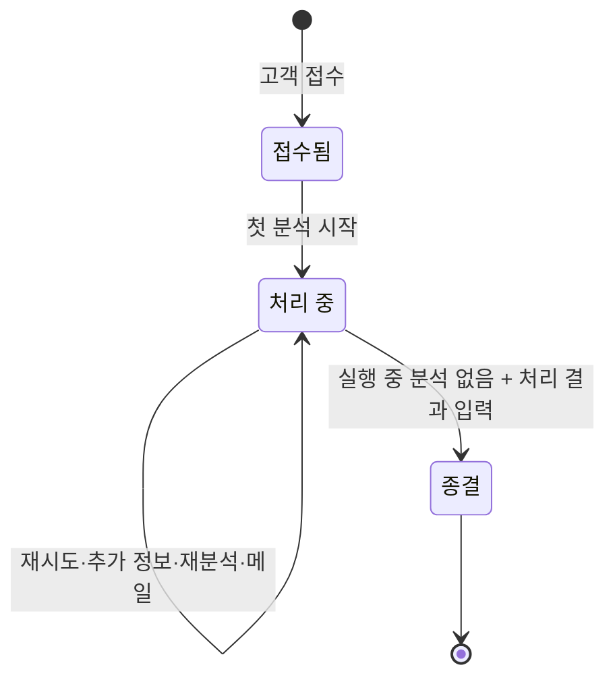
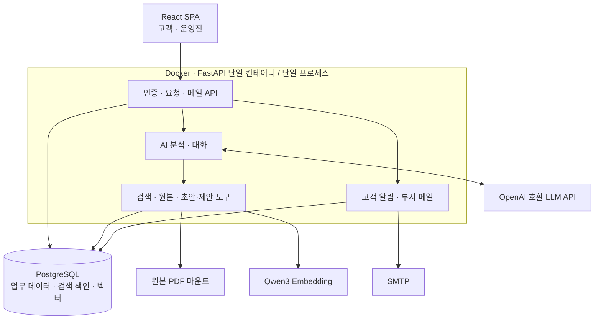
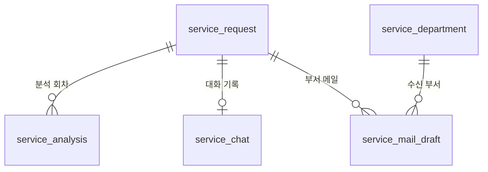

# MORRONO 기능 요구 명세서

## 1. 개요

- 목적: 공작기계 A/S 요청을 기준으로 매뉴얼·과거 사례 검색, AI 검토 지원, 부서 메일과 종결 처리 연결
- 고객: 자기 회사 요청의 접수·진행 상황·처리 결과 확인
- 운영진: 전체 요청의 AI 분석·대화·근거 검토·메일·종결 처리
- 우선순위: **Must**는 핵심 흐름·안전 통제, **Should**는 운영·사용성 지원
- 계정은 관리용 CLI로 사전 등록. 공개 회원가입과 부서별 별도 작업 계정은 범위에서 제외

## 2. 기능 요구사항

### 2.1 인증·접수·조회

| ID | 기능 | 요구사항·인수 기준 | 우선순위 |
|---|---|---|---|
| FR-01 | 로그인·로그아웃 | 서버 세션으로 인증. 로그아웃 후 기존 세션으로 보호 API 접근 불가 | Must |
| FR-02 | 역할·회사별 접근 | 고객은 자기 회사 요청만 조회. 운영진은 전체 조회. 고객의 분석·대화·부서 설정·원본 열람 접근 차단 | Must |
| FR-03 | 고객 전용 접수 | 고객만 기종·접수 사유·메시지로 접수. 미입력·공백 메시지·미등록 기종 거부. 운영진 접수 API는 403 | Must |
| FR-04 | 접수자·회사 기록 | 로그인 계정과 소속으로 서버가 기록. 브라우저에서 임의 접수자·회사 지정 불가 | Must |
| FR-05 | 요청 목록 | 고객·운영진별 목록 조회, 상태·기종 등 화면 필터와 정렬 제공. 운영진 목록은 좁은 화면에서 카드 표시 | Should |
| FR-06 | 고객 상세 | 접수 내용·상태·고객용 이력 제공. 종결 후 처리 결과 공개. AI 결과·대화·기술 자료·내부 메일은 미제공 | Must |

### 2.2 분석·검색·대화

| ID | 기능 | 요구사항·인수 기준 | 우선순위 |
|---|---|---|---|
| FR-07 | 분석 시작 | 운영진이 실행. 첫 실행 시 `접수됨 → 처리 중`과 고객용 시작 이력을 같은 트랜잭션에서 기록. 재시도 시 이력 중복 금지 | Must |
| FR-08 | 분석 상태·결과 | 실행 상태 조회, 요약·원인 후보·권장 메일 활동·근거 표시. 실패 코드 제공 및 재시도 가능 | Must |
| FR-09 | 하이브리드 검색 | 매뉴얼의 식별자 정확 조회와 증상 검색을 구분. 키워드·trigram·벡터 순위를 RRF로 결합. 벡터 미사용·실패 시 다른 검색 경로 이용 | Must |
| FR-10 | 번호 사전 확인 | 서버에서 본문·추가 정보의 번호를 추출·조회. `찾음 / 찾지 못함 / 조회 실패`를 구분해 결과 기록 | Must |
| FR-11 | 분석 근거 검증 | 조회 기록에 없는 출처 거부. 발췌문은 DB에서 구성. 원인별 근거 연결·ID 유효성 검사. 근거가 없으면 원인·부품·부서 추천 제거 | Must |
| FR-12 | 원본 페이지 | 서버가 보유한 출처 참조로 PDF 페이지 이미지 제공. 운영진만 열람하며 이전 분석 회차도 조회 가능. 파일 누락·불일치는 열람 실패 처리 | Must |
| FR-13 | 운영진 대화 | 첫 분석 성공 후 이용. 서버의 요청별 대화 기록으로 문맥 구성하고 답변 스트리밍. 종결 후에는 새 질문 불가, 열람만 가능 | Must |
| FR-14 | 과거 사례 상세 | 대화 도구로 FSR의 상세·가명 담당 기록 조회. 담당 기록은 검색·임베딩·자동 분석 입력에서 제외 | Should |
| FR-15 | 이력·메일 조회 | 대화 도구로 현재 요청의 처리 이력, 부서 메일 목록·발송 상태·메일 전문 조회 | Should |

### 2.3 후속 업무·메일

| ID | 기능 | 요구사항·인수 기준 | 우선순위 |
|---|---|---|---|
| FR-16 | 부서 메일 작성 | 권장 활동에서 고정 양식 제공, 명시적 AI 작성 요청 시 제목·본문 생성. 대화 도구로는 초안 저장 가능. 작성·저장만으로 발송 금지 | Must |
| FR-17 | 부서 메일 발송 | 운영진이 검토·수정 후 발송. 서버의 활성 부서·등록 주소만 이용. 발송 중 중복 실행 차단 및 성공·실패 상태 기록 | Must |
| FR-18 | 부서 설정 | 이름·설명·수신 주소·사용 여부 수정, 부서 추가, 마지막 변경자·시각 기록. 설명은 AI의 부서 선택 참고이며 자동 발송 조건이 아님 | Should |
| FR-19 | 추가 정보 제안 | 대화로 추가 정보 저장을 제안하고 운영진 확인 후 작성자·시각과 함께 누적 저장. 제안만으로 분석 입력 반영 금지 | Must |
| FR-20 | 재분석 | 버튼 또는 제안 카드에서 운영진 실행. 저장된 추가 정보를 입력에 반영하고 회차별 결과 보관. 정보 저장만으로 자동 실행 금지 | Must |
| FR-21 | 요청 종결 | `처리 중`이며 실행 중 분석이 없을 때 처리 결과 입력 후 종결. 고객 화면에 `완료`와 작성 결과 공개 | Must |
| FR-22 | 고객 상태 알림 | SMTP 활성화 및 유효한 이메일 로그인 계정인 경우 접수·처리 시작·종결 시 고정 양식 알림. 종결 알림에는 운영진의 처리 결과 포함 | Should |
| FR-23 | 메일 비활성화·실패 | SMTP 미설정 시 고객 알림 생략·부서 발송 거부. 부분·잘못된 설정은 경고 후 비활성화. 실패 자동 재발송 금지 | Must |

부서 추가는 대화의 메일 초안 대상에 반영되지만, 구조화 분석의 자동 추천·권장 활동은 서비스·품질·부품·영업 4개 부서로 제한.

## 3. 상태와 업무 규칙

- 분석 실패·서버 재시작으로 인한 중단 후에도 요청은 `처리 중` 유지
- 요청당 실행 중 분석은 1건으로 제한. 대화 답변 생성도 요청당 1건으로 제한
- 분석 회차와 요청 상태는 별개. 분석 성공이 곧 종결을 의미하지 않음
- 종결된 요청의 대화는 읽기 전용이며 후속 처리 작업 차단
- 고객에게 기술 가이드·매뉴얼 원본·AI 결과는 종결 후에도 공개하지 않음

## 4. AI 활용 명세

| 항목 | 명세 |
|---|---|
| 입력 | 접수 기종·사유·증상, 저장된 추가 정보, 조회된 매뉴얼·사례 |
| 구조화 분석 | 요약, 원인 후보, 점검 순서, 확인 사항, 부품, 인용 근거, 고정 4개 부서 추천 등 생성·저장 |
| 기본 분석 UI | 요약·원인·권장 메일 활동·근거 표시. 저장된 점검 순서는 기본 UI에 미표시 |
| 도구 | 전체 12종 중 구조화 분석은 검색·조회 4종, 운영진 대화는 전체 12종 사용 |
| 원본 열람 | 분석 도구는 페이지 이미지+텍스트, 대화 도구는 텍스트 제공. 운영진 화면의 원본 보기는 이미지 제공 |
| 검증 경계 | 구조화 분석은 실제 조회 기록·출력 스키마·근거 연결 검사. 자유 서술 대화에는 동일 검증 미적용 |
| 프롬프트 | 번호·수치 추측 금지, 근거 부족 명시, 보증·책임 확정 금지, 접수·검색 내용을 지시가 아닌 데이터로 취급 |
| 실행 권한 | AI는 초안·제안 저장 가능. 실제 발송·추가 정보 반영·재분석·종결은 운영진 명시적 실행 필요 |

### 실행·입력 제한

| 항목 | 제한 |
|---|---|
| 접수 메시지 | 1~10,000자, 공백만 입력 불가 |
| 추가 정보·종결 결과 | 각 입력 최대 2,000자 |
| 대화 | 요청당 사용자 질문 최대 30개, 질문당 최대 2,000자 |
| 구조화 분석 | 시도당 도구 호출 최대 12회, 원본 열람 최대 3회, 모델 요청 최대 16회 |
| 대화 모델 요청 | 질문당 최대 16회 |
| 분석 목록 길이 | 원인 최대 3개, 점검 최대 5개, 확인 사항 최대 3개로 서버 제한 |

요약 2문장은 프롬프트 지시이며 서버의 문장 수 강제 제한은 아님. 재시도 시 도구·모델 사용 한도는 새 시도 기준으로 초기화.

## 5. 비기능 요구사항

| ID | 항목 | 요구사항·검증 기준 |
|---|---|---|
| NFR-01 | 접근 보안 | 서버에서 역할·회사별 접근 검사. UI 숨김만으로 보호하지 않으며 다른 회사 요청·고객의 운영진 API 접근 거부 확인 |
| NFR-02 | 인증·요청 위조 방지 | Argon2 비밀번호 해시, 서버 세션·HttpOnly 쿠키, HTTPS 환경의 Secure 쿠키, 쓰기 API의 Origin·CSRF 검사 |
| NFR-03 | AI 실행 통제 | §4의 호출·입력 제한 적용. 임의 발송 주소·실행 권한을 모델에 위임하지 않음 |
| NFR-04 | 동시성·정합성 | 행 잠금·실행 중 분석의 부분 유니크 인덱스로 중복 실행 제한. 상태·고객 이력·알림 대기열의 트랜잭션 경계 검증 |
| NFR-05 | 장애 처리 | 일시적 모델 오류는 최대 3회 시도, 2초·6초 대기. 영구 오류는 즉시 실패. 출처·결과 검증 위반은 새 실행으로 1회 재시도 |
| NFR-06 | 오류 정보 보호 | 모델·DB·SMTP 오류 원문을 사용자에게 전달하지 않고 고정 코드·안내 사용 |
| NFR-07 | 개인정보 최소화 | 연락처·호기를 별도 수집하지 않음. 부서 수신 주소를 AI 도구 응답에서 제외. `EMP-숫자` 담당 ID가 포함된 메일 저장·발송 거부 |
| NFR-08 | AI 고지 | 분석·대화의 검토용 초안 안내와 AI 생성 표시, 로그인·푸터 안내 제공. 최종 판단을 대신하지 않음을 명시 |
| NFR-09 | 반응형·사용성 | 고객 접수·조회와 운영진 목록·상세를 좁은 화면에서도 이용 가능. 목록 카드·필터 재배치·명시적 상태 및 오류 안내 확인 |
| NFR-10 | 배포·복구 | 외부 HTTPS 제공, DB 변경 전 백업, 버전 관리된 마이그레이션 사용. 앱 시작 시 스키마 자동 변경 금지 |
| NFR-11 | 운영 환경 | 실행 복구·대화 동시성은 서버 프로세스 1개 전제. PDF는 DB 경로에 존재하고 색인의 SHA-256과 일치 |
| NFR-12 | 검증 가능성 | 모델·메일 대역을 사용하는 격리 DB 회귀 테스트와 실제 모델·실사용자 검증을 구분. 측정 전 응답 속도·가용성·정확도 수치 미확정 |

개인정보가 포함된 실제 업무 자료를 사용하기 전 동의·LLM 전달 범위·보관 기간·삭제 절차에 대한 별도 운영 정책 점검 필요. 현재 기술 통제를 포괄적인 개인정보보호 준수 인증으로 해석하지 않음.

## 6. 시스템 아키텍처

### 주요 데이터 관계

회사의 요청 접근은 소속 테이블을 기준으로 판단. 검색 자료·벡터와 업무 기록은 별도 테이블에 저장. 실제 전체 스키마는 `backend/migrations/` 참고.

## 7. 검증 시나리오

| 시나리오 | 관련 요구사항 | 기대 결과 |
|---|---|---|
| 고객 접수 → 운영진 분석 → 종결 → 고객 확인 | FR-03~08, FR-21 | 상태·이력 일치, 운영진 처리 결과만 고객에게 공개 |
| 운영진 접수·타사 요청·고객의 원본 열람 시도 | FR-02~03, FR-12 | 권한에 맞게 거부, 데이터 미노출 |
| 없는 번호·조회하지 않은 출처·근거 없는 분석 | FR-10~11 | 상태 구분, 잘못된 출처 거부, 근거 부족 처리 |
| 분석 중 중복 실행·종결 시도, 서버 재시작 | FR-07, FR-21, NFR-04~05 | 중복·종결 거부, 중단 기록 및 재시도 가능 |
| 대화에서 추가 정보·재분석·메일 제안 | FR-13, FR-16~20 | 제안·초안만 저장, 운영진 확인 전 실제 작업 미실행 |
| SMTP 미설정·실패·중복 발송 시도 | FR-17, FR-22~23 | 정해진 비활성화·실패·중복 방지 처리 |
| 실제 PDF와 색인 연결 확인 | FR-12, NFR-11 | 텍스트 검색과 별개로 원본 이미지 렌더링 성공 |
| 고객·운영진의 모바일 핵심 과업 | FR-05, NFR-09 | 목록·필터·접수·상세 이용 가능, 주요 조작이 화면 밖으로 잘리지 않음 |

자동화 근거는 `backend/tests/`, `frontend/src/*.test.js`, `frontend/e2e/`에 보관. 실제 모델 인수 테스트는 별도 live 스크립트·설정으로 명시적으로 실행.

서비스 구축 방안·추진 일정과 사용자 검증 계획은 [프로젝트 기획서](프로젝트_기획서.md) 참고. 발표용 요약은 [HTML 발표 자료](발표자료.html) 참고.
