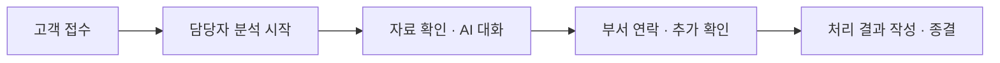

# MORRONO 프로젝트 기획서

공작기계 A/S 요청 AI 분석 서비스

> 현재 구현을 바탕으로 정리한 기획서. 실사용자 테스트 결과와 성능 개선 수치는 미확보 상태로, 검증 전 성과 기재 제외.

## 1. 추진 배경 및 목표

### 주요 문제

- **자료 확인의 어려움:** 기계 매뉴얼과 과거 수리 기록의 개별 검색 필요
- **정확한 정보 확인의 부담:** 기종·알람 번호·부품번호에 따른 내용 대조 필요
- **업무 기록의 분산:** 자료 확인·부서 연락·고객 안내를 따로 관리하는 과정의 불편

### 추진 목표

- 고장 접수부터 자료 확인, 부서 연락, 처리 결과 안내까지 한곳에서 관리
- AI의 관련 자료 검색을 통한 담당자의 원인 검토 및 업무 준비 지원
- 고객의 접수 내용·진행 상태·최종 처리 결과 확인 편의 제공

## 2. 대상 사용자 및 주요 기능

| 대상 | 주요 기능 |
|---|---|
| 고객사 사용자 | 고장 접수, 같은 회사의 요청 조회, 진행 상태·처리 결과 확인 |
| 서비스 담당자(운영진) | AI 분석·대화, 관련 자료·매뉴얼 원본 확인, 재분석, 부서 메일 작성·발송, 요청 종결 |

### 서비스 이용 흐름

- 신규 접수: 고객 계정 전용
- 요청 상태: `접수됨 → 처리 중 → 종결`, 고객 화면의 종결 상태는 `완료`로 표시
- 서비스·품질·부품·영업 부서: 협조 요청 메일 수신, 별도 작업 화면 제외
- 고객용 AI 상담·매뉴얼 공개, 자동 수리 판단·설비 제어: 서비스 범위에서 제외

## 3. AI 활용 방안

| 구분 | 적용 내용 및 목적 |
|---|---|
| AI Agent | 검색·원본 확인 도구를 활용한 관련 자료 탐색, 분석 결과와 메일 초안 작성 지원 |
| RAG(검색 증강 생성) | 검색한 매뉴얼·과거 수리 기록을 참고한 원인 검토 지원 |
| 멀티모달(텍스트·이미지 활용) | 분석 중 PDF 원본 열람 시 이미지와 텍스트를 함께 활용한 표·도면 대조 |

### AI와 담당자의 역할 구분

- AI: 관련 자료 검색, 원인 후보·확인 사항 제시, 메일 초안 및 재분석 제안
- 담당자: 자료·현장 상황 확인, 최종 판단, 메일 발송·재분석·종결 실행
- 오판 방지: 알람·부품번호의 정확 일치 조회, 구조화 분석의 인용 출처 검사, 근거 부족 시 추가 확인 안내
- 활용 한계: 출처 검사만으로 진단 정확성 보장 불가, 자유 서술 대화에 대한 담당자의 별도 사실 확인 필요

## 4. 서비스 구현 방안

### 주요 기술 및 도입 목적

| 영역 | 적용 기술 | 도입 목적 |
|---|---|---|
| 화면 | React + Vite | 고객·담당자 화면 구성, 분석·대화 진행 상태 표시, 기기별 반응형 화면 제공 |
| API | FastAPI + Pydantic | 검색·문서 처리 기능 연결, 요청·응답 데이터 형식 검사 |
| AI | PydanticAI, OpenAI 호환 API, Qwen3 Embedding | AI 도구 호출·분석 결과 생성, 모델 제공자 연결 분리, 글의 의미 기반 검색 지원 |
| DB·검색 | PostgreSQL + pgvector + pg_trgm | 업무 기록·검색 자료 관리, 키워드·문자열 유사도·벡터 검색 연계 |
| 배포·메일 | Docker, SMTP | 화면·API의 동일 주소 제공, 기존 이메일 업무와 고객 알림 연계 |

### 자료 준비 및 운영

- **매뉴얼:** 원본 PDF와 페이지별 변환 텍스트 확보 및 검색용 자료 구성
- **과거 수리 기록:** 조치 내역이 있는 FSR 선별 및 중복 정리
- **외부 배포:** Docker 기반 HTTPS 서비스 제공, 데모 주소 <https://demo.morrono.com>
- **개인정보 보호:** 회사·역할별 접근 제한, 실제 개인정보 사용 전 동의·보관·삭제 정책 점검 필요
- **호출·발송 관리:** AI 실행 한도 적용, 담당자의 초안 확인 후 메일 발송, 수동 재발송 전 실제 발송 여부 확인

세부 기능·시스템 구성은 [기능 요구 명세서](기능_요구_명세서.md), 실행·운영 방법은 [README](README.md) 참고.

## 5. 추진 일정

| 구분 | 일정 | 주요 작업 | 상태 |
|---|---|---|---|
| 기본 구성 | 2026-10-28 | 화면·API·DB 및 배포 구성 | 완료 |
| 검색·접근 관리 | 2026-11-01 | 검색 기능·로그인·검색 Agent 구현 | 완료 |
| 화면 개선 | 2026-11-09 | 반응형 테마·AI 활용 안내 추가 | 완료 |
| 처리 흐름 구성 | 2026-11-15~16 | 분석·대화·메일·종결 연결, 고객 전용 접수·운영진 화면 개선 | 완료 |
| 사용자 검증 준비 | D | 최소 5명 모집, 시나리오·테스트 자료·계정 준비 | 예정 |
| 사용자 검증 | D+1 | 실사용자 테스트·인터뷰 및 의견 기록 | 예정 |
| 개선 | D+2 | 피드백 분류, 우선 문제 수정 및 이력 관리 | 예정 |
| 재검증·발표 준비 | D+3 | 개선 결과 확인, 문서·발표 자료 보완 | 예정 |

- 완료 항목: Git 이력으로 확인한 개발 작업 기준
- 향후 일정: 사용자 검증 착수일을 D로 설정, 실제 일정·참여자 확정 필요

## 6. 사용자 검증 계획

- **참여자:** 최소 5명, 고객 역할과 담당자 역할로 구분
- **검증 범위:** 고객의 접수·상태 확인, 담당자의 분석·자료 확인·메일 준비, 종결 결과 확인
- **확인 항목:** 과업 완료 여부, 소요 시간, 막힌 지점, 용어 이해도, AI 답변의 출처 확인 가능 여부
- **의견 수집:** 익명 참여자 ID, 이용 과정 관찰, 테스트 후 질문, 개인정보·업무 기밀 대신 테스트 자료 사용
- **개선 절차:** 의견 수집 → 문제 분류 → 수정 → 동일 과업 재검증
- **AI 품질 확인:** 실제 모델의 출처·추천 내용과 근거 부족 시 안내 검토, 모형 응답을 사용하는 회귀 테스트와 구분

**현재 검증 상태:** 최소 5명의 실사용자 테스트 결과 미확보, 응답 시간 단축률·진단 정확도·사용자 만족도 미측정. 자동화 테스트·개발자 점검과 구분하여 향후 결과 기록 예정.

---

관련 문서: [기능 요구 명세서](기능_요구_명세서.md) · [발표 자료](발표자료.html) · [프로젝트 README](README.md)
